<p align="center">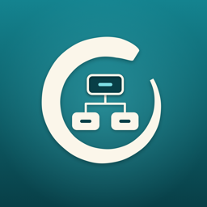</p>

# Kata

[](https://github.com/meysampg/Kata/actions/workflows/ci.yml)
[](LICENSE)


Kata is an iOS app for mastering software design patterns through deliberate practice, the way a martial artist drills a kata: small, exact forms, repeated until they are second nature.

<p align="center">
<table>
  <tr>
    <td align="center">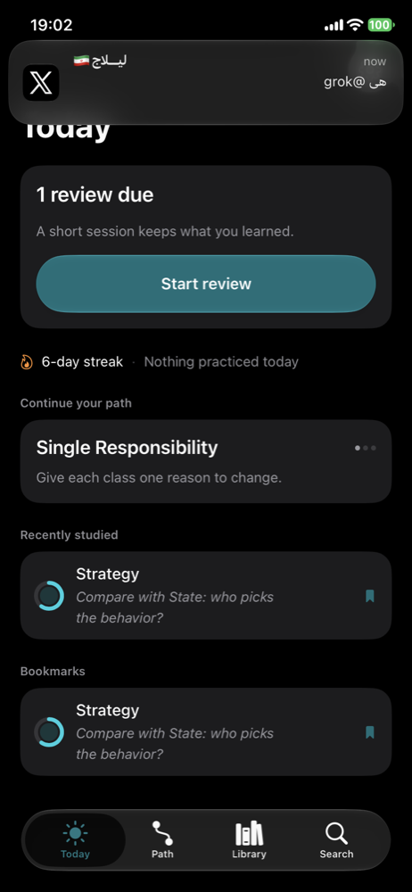<br><sub>Today</sub></td>
    <td align="center">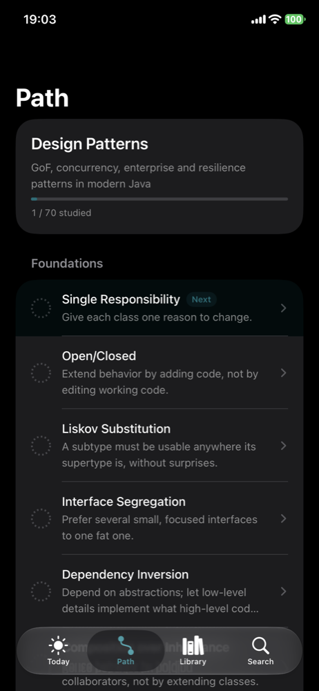<br><sub>Guided path</sub></td>
    <td align="center">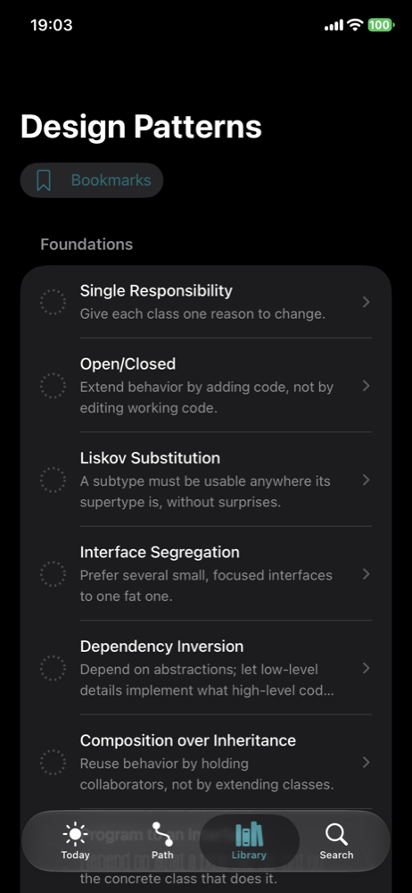<br><sub>Library</sub></td>
    <td align="center">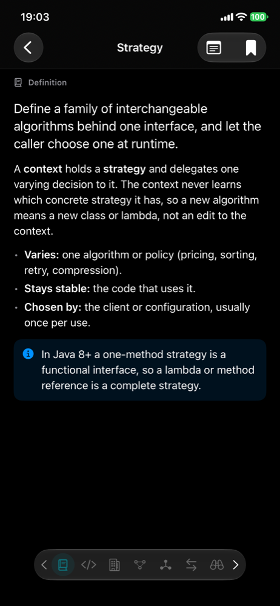<br><sub>Definition</sub></td>
  </tr>
  <tr>
    <td align="center">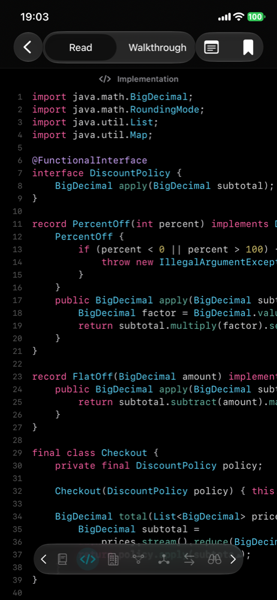<br><sub>Implementation</sub></td>
    <td align="center">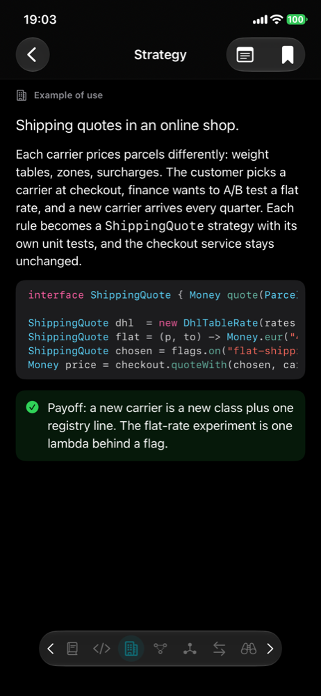<br><sub>Example of use</sub></td>
    <td align="center">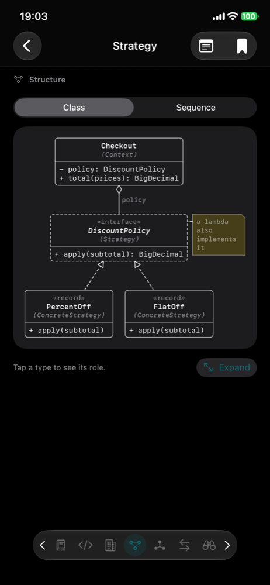<br><sub>Structure</sub></td>
    <td align="center">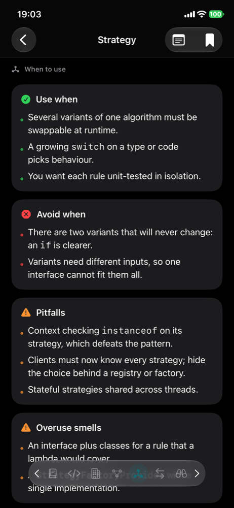<br><sub>When to use</sub></td>
  </tr>
  <tr>
    <td align="center">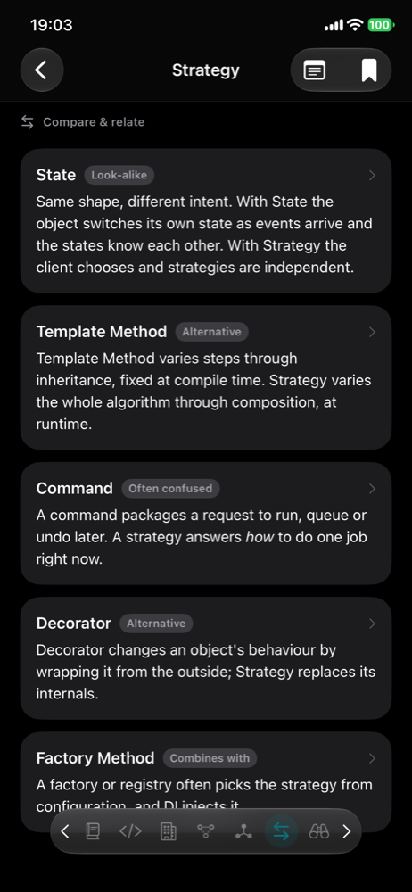<br><sub>Compare & relate</sub></td>
    <td align="center">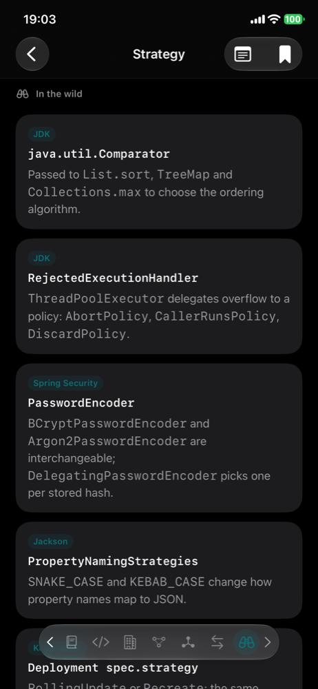<br><sub>In the wild</sub></td>
    <td align="center">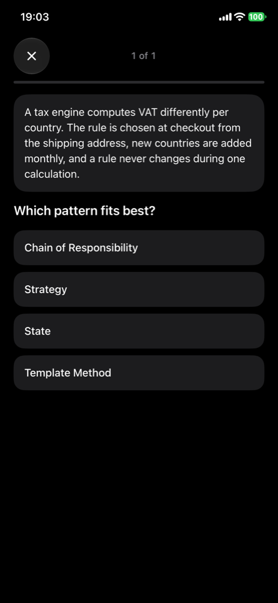<br><sub>Practice</sub></td>
    <td align="center">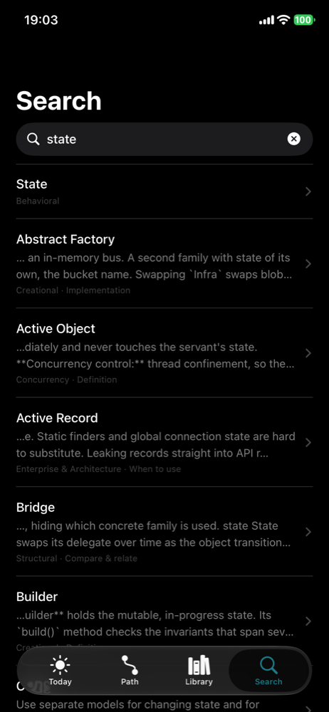<br><sub>Search</sub></td>
  </tr>
  <tr>
    <td align="center">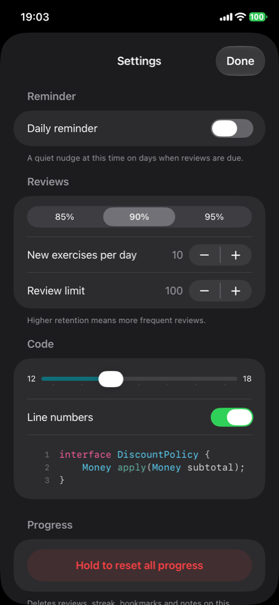<br><sub>Settings</sub></td>
  </tr>
</table>
</p>
<p align="center"><sub><a href="docs/screenshots/">All screenshots, individually</a></sub></p>

## Why

I wanted to actually retain design patterns, not just read about them once. Kata is a personal learning app built around one focus item per screen: one card, one idea, then a short exercise on it, then a spaced review later. It is free and open source, English only, and works entirely offline.

## Features

- Seven focus cards per pattern, one per screen: **Definition**, **Implementation** (a stepped code walkthrough with its output), **Example of use**, **Structure** (UML class and sequence diagrams, drawn natively), **When to use / avoid**, **Compare & relate** and **In the wild**
- Five practice types: identify the pattern, choose the right one for a scenario, tap the flawed line, reorder code blocks, and free recall against a model answer
- FSRS-5 spaced repetition schedules every exercise; you choose the target retention (85%, 90% or 95%) and daily limits
- A guided path through the whole topic with everything open: nothing is locked
- Mastery rings, a daily streak and a today view with your next review
- Search, bookmarks and a short note on any item
- An optional daily reminder
- Light and dark appearance, Liquid Glass on iOS 26
- Fully offline: content is bundled, progress stays on the device

## Content

The first topic is **Design Patterns** in modern Java: 8 foundations and 62 patterns, 70 items in all.

| Category | Items |
|---|---|
| Foundations (SOLID and friends) | 8 |
| Creational | 5 |
| Structural | 7 |
| Behavioral | 11 |
| Concurrency | 10 |
| Enterprise & Architecture | 15 |
| Resilience & Cloud | 14 |

**Status:** all 70 items are complete, each with every card of its template and five practice exercises (350 in total). Every item was reviewed for technical accuracy, and the tests compile and run all 279 Java 21 units, checking each sample's printed output against what its card shows.

## Architecture

```
Kata (iOS app)                    SwiftUI, SwiftData, notifications
  App · Features (Today, Path, Library, Deck, Practice, Search, Settings)
  Persistence · DesignSystem · Notifications
        │ import
        ▼
KataKit (local Swift package)
  KataSRS      FSRS-5 scheduler, streaks (Foundation only)
  KataCode     Java lexer, HighlighterRegistry
  KataDiagram  diagram model, class and sequence layouts, linter
  KataCore     models, pack loader, learning engine, search, validation
  KataUI       SwiftUI renderers: code, diagrams, blocks, mastery ring
  kata-pack    CLI: build, validate, check-java
```

Content is authored as JSON and code files under `Content/topics/`, built into a `.kpack` by `kata-pack`, and decoded by the app at launch. Pure logic lives in the package and is tested on the host with `swift test`. Details, schemas and rules are in [docs/ARCHITECTURE.md](docs/ARCHITECTURE.md); the product plan is in [docs/PLAN.md](docs/PLAN.md).

## Adding a new topic

A topic (for example Networking or System Design) needs no Swift changes.

1. Create `Content/topics/<id>/topic.json` with `schemaVersion`, `id`, `title`, `subtitle`, `symbol`, `codeLanguage`, `roles`, `templates`, `requiredExercises`, `categories`, `items` (the registry: id, title, category, difficulty, aliases, intent) and `path` (ordered, titled sections of item ids). Use `Content/topics/design-patterns/topic.json` as the model.
2. Add each item as `Content/topics/<id>/items/<item-id>/item.json` (cards and exercises) plus its code files. Code files mark regions with `// [[id` ... `// ]]` for the walkthrough. Items in the registry without a body show as "Coming soon".
3. Validate and build:

   ```sh
   swift run --package-path Packages/KataKit kata-pack validate --topic <id>
   swift run --package-path Packages/KataKit kata-pack check-java --topic <id>   # when the topic uses Java
   swift run --package-path Packages/KataKit kata-pack build --topic <id>
   ```

4. The build writes `Kata/Resources/Packs/<id>.kpack`. The app loads every `.kpack` in its bundle, so the new topic appears with no code change. With more than one topic, the Library lists topics and the Path tab gets a topic menu.

Notes:

- **Card types** are reusable and chosen per role: text, code, diagram, lists, comparison and references.
- **Roles and templates** are per topic. `roles` define the cards (title, symbol, type); `templates` say which roles an item has (Design Patterns has `pattern` and `principle`); each category picks a template.
- **Code language** is per topic (`codeLanguage`, and per-card `language`). Highlighting goes through `HighlighterRegistry` in `KataCode`; add a `SyntaxHighlighter` for a new language and register it there.
- **Ids are stable forever**: progress is keyed by item and exercise ids, so never rename them.
- Other `kata-pack` options: `--items a,b` to limit to some items, `--allow-missing` for `validate`, `--content <dir>` and `--out <dir>` to change the source and output folders.

## Build and run

- Xcode 27 or newer; the app targets iOS 26.
- Run the package tests: `swift test --package-path Packages/KataKit` (Java 21 is needed for the content tests)
- Build for the simulator:

  ```sh
  xcodebuild -project Kata.xcodeproj -scheme Kata -configuration Debug \
    -destination 'generic/platform=iOS Simulator' CODE_SIGNING_ALLOWED=NO build
  ```

- To run on a device, see [Install on your iPhone](#install-on-your-iphone).
- Screenshots: `Tools/capture_screenshots.sh [device-udid] [out-dir]` uses the DEBUG demo mode (`-KataDemo YES -KataScreen <screen>`) on a connected iPhone, so real progress is untouched.

## Install on your iPhone

```sh
Tools/install.sh                 # builds, installs and launches; asks which device if several are connected
Tools/install.sh "Other iPhone"  # a UDID or part of the device name (see `xcrun devicectl list devices`)
```

1. Connect the iPhone by USB (or pair it on the same network) and tap Trust. The iCloud account on the phone does not matter.
2. Turn on Developer Mode: Settings > Privacy & Security > Developer Mode, then restart.
3. Run the script. Xcode registers the device with your team automatically (`-allowProvisioningUpdates`).
4. After the first install, trust the developer: Settings > General > VPN & Device Management > your Apple ID > Trust. Then open the app.
5. With a free Apple ID the build expires after 7 days; run `Tools/install.sh` again to re-sign it (`Tools/renew.sh` does the same for the owner's phone).

To sign with a different Apple ID, pass its team and a bundle id that is unique to that team (free teams cannot share ids):

```sh
TEAM=ABCDE12345 BUNDLE_ID=com.example.kata Tools/install.sh
```

Other options: `CONFIG=Release`, `NO_PULL=1` (skip `git pull`).

## Content authoring

```sh
swift run --package-path Packages/KataKit kata-pack validate --topic design-patterns
swift run --package-path Packages/KataKit kata-pack check-java --topic design-patterns
swift run --package-path Packages/KataKit kata-pack build --topic design-patterns
```

## License and privacy

- The source code is released under the [MIT licence](LICENSE).
- Kata collects nothing and works offline; see the [privacy policy](PRIVACY.md).

## More

- [Contributing](CONTRIBUTING.md)
- [Architecture](docs/ARCHITECTURE.md)
- [Plan](docs/PLAN.md)
